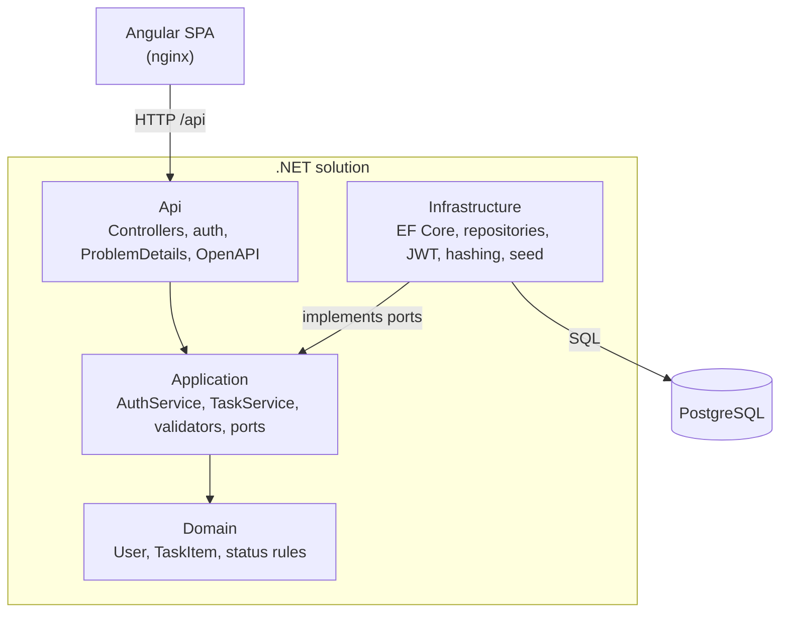
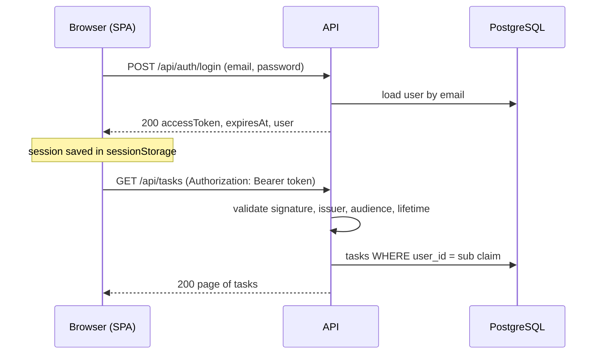
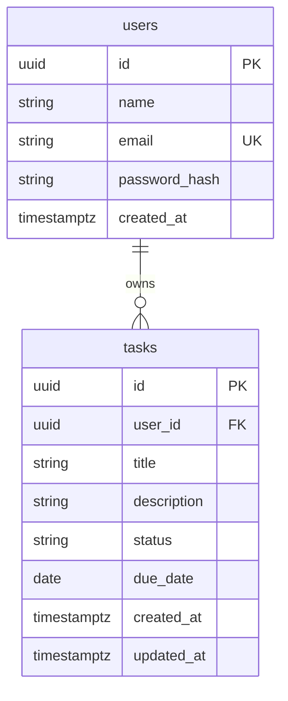
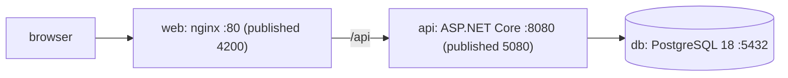

# Architecture

How the Task Manager is built. Decisions are in [docs/adr/](adr); feature designs are in [docs/design/](design).

## Layers and the dependency rule

Four .NET projects. Dependencies point inward: Domain depends on nothing, Application depends on Domain, Infrastructure and Api depend on Application. Api is the composition root and wires dependency injection. Architecture tests enforce the rule ([ADR-0002](adr/0002-clean-architecture-four-projects.md), [ADR-0008](adr/0008-testing-strategy.md)).

| Project | Rule |
| --- | --- |
| Domain | No NuGet packages. Holds invariants. |
| Application | No EF Core, no ASP.NET Core. Returns `Result<T>` for expected failures. |
| Infrastructure | Implements the ports (`ITaskRepository`, `IUserRepository`, `ITokenService`, `IPasswordHasher`). |
| Api | Never returns entities; maps results to HTTP. |

Not used: MediatR, AutoMapper, `IUnitOfWork` ([ADR-0007](adr/0007-no-mediatr-automapper-fluentassertions-uow.md)). Time comes from the injected `TimeProvider`.

## Request flow

Three hops from the controller to the database.

1. The controller receives the request and calls an application service.
2. The service validates the input (FluentValidation), applies domain rules through the entity, and calls a repository port.
3. The repository (EF Core) runs the query. Every task query filters by the current user inside the repository, using the user id from `ICurrentUser` (the token).
4. The service returns `Result<T>`; the controller maps it to a response DTO or a ProblemDetails.

### Result to ProblemDetails

Expected failures are values, not exceptions ([ADR-0006](adr/0006-result-pattern.md)). A `Result<T>` carries a typed `Error` with an `ErrorType` and a code.

| ErrorType | HTTP | Example code |
| --- | --- | --- |
| Validation | 400 (with `errors` by field) | `validation` |
| Unauthorized | 401 | `auth.invalid_credentials`, `auth.invalid_token` |
| NotFound | 404 | `task.not_found` |
| Conflict | 409 | `auth.email_taken` |

Unexpected exceptions go to a global handler that returns a ProblemDetails with no stack trace (500). The full catalog is in [api.md](api.md).

## Authentication flow

[ADR-0005](adr/0005-jwt-bearer-authentication.md), [DD-01](design/DD-01-authentication.md).

- JWT signed with HS256, valid for 60 minutes, no refresh token. The key comes from the environment.
- A fallback authorization policy protects every endpoint; only register, login, status, health and the OpenAPI pages are anonymous.
- Login is rate limited to 5 attempts per minute per IP. Unknown email and wrong password give the same error. Behind the compose nginx the client address comes from `X-Forwarded-For`, trusted only from private networks (10.0.0.0/8, 172.16.0.0/12, 192.168.0.0/16). Outside the local Docker setup, set the trusted proxy networks in `Program.cs` to the real proxy.
- The SPA keeps the session in `sessionStorage` ([ADR-0010](adr/0010-browser-token-storage.md)). On any 401 it clears the session and goes to the login page.

## Data model

PostgreSQL through EF Core, migrations in `Infrastructure/Persistence/Migrations` ([ADR-0003](adr/0003-postgresql-with-ef-core.md)).

| Item | Detail |
| --- | --- |
| Ids | GUID version 7, created in the domain |
| `ix_users_email` | Unique index; the database decides duplicates, so two simultaneous registrations cannot both succeed |
| `ix_tasks_user_id_status_due_date` | Supports the list query: filter by user and status, order by due date |
| Foreign key | `tasks.user_id` to `users.id`, cascade delete |
| Status | Stored as a string (`Todo`, `InProgress`, `Done`) |
| Overdue | Computed on each request, never stored |

## Frontend structure

Angular 21, standalone components, Angular Material, Vitest ([DD-03](design/DD-03-frontend.md), [ADR-0009](adr/0009-angular-signal-stores.md)).

| Folder | Content |
| --- | --- |
| `core/auth` | `AuthService`, `TokenStorage`, `authGuard`, `authInterceptor` |
| `core/http` | `errorInterceptor` (401: logout and redirect to login with `returnUrl`; snackbar on network and 5xx errors) |
| `core/models` | Typed API models |
| `shared/ui` | Confirm dialog, empty state, loading, status badge |
| `layout` | `ShellComponent` (toolbar and outlet) |
| `features/auth` | Login and register pages |
| `features/tasks` | List, form, task card, filters, API service, `TasksStore` |

- **Signal stores**: one injectable store per feature holds state in `signal()` and `computed()`. API services only do HTTP.
- **Lazy routes**: `tasks` and `auth` are loaded with `loadChildren`.
- **Guard and interceptors**: `authGuard` protects `/tasks`; `authInterceptor` adds the Bearer token to `/api` calls; `errorInterceptor` logs out and redirects to login with `returnUrl` on 401 and shows a snackbar on network and 5xx errors. The pages map ProblemDetails to field and form errors.

## Testing pyramid

[ADR-0008](adr/0008-testing-strategy.md). Counts change with every commit; see CI for the current numbers.

| Level | Project | Tools |
| --- | --- | --- |
| Architecture | `TaskManager.ArchitectureTests` | NetArchTest |
| Unit | Domain, Application and Api unit tests | xUnit v3, Shouldly, NSubstitute, `FakeTimeProvider` |
| Integration | `Infrastructure.IntegrationTests` | Testcontainers (PostgreSQL), Respawn |
| End to end API | `Api.IntegrationTests` | `WebApplicationFactory`, Testcontainers |
| Frontend | Component, store, guard and interceptor specs | Vitest |

Integration tests use a real PostgreSQL instead of EF Core InMemory, so unique indexes, foreign keys and migrations are tested. They carry `[Trait("Category", "Integration")]`.

## Runtime

[DD-04](design/DD-04-runtime-and-quality.md). Docker Compose runs three services.

| Service | Notes |
| --- | --- |
| `db` | Volume `pgdata`; health check `pg_isready` |
| `api` | Waits for a healthy `db`; health check `GET /health` (checks the database). Development applies migrations and the demo seed at startup. |
| `web` | Waits for a healthy `api`; serves the SPA and proxies `/api` |

Secrets and connection settings come from environment variables (`.env`, git-ignored; `.env.example` has demo values).
