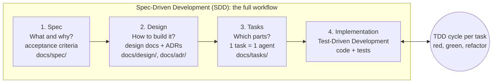
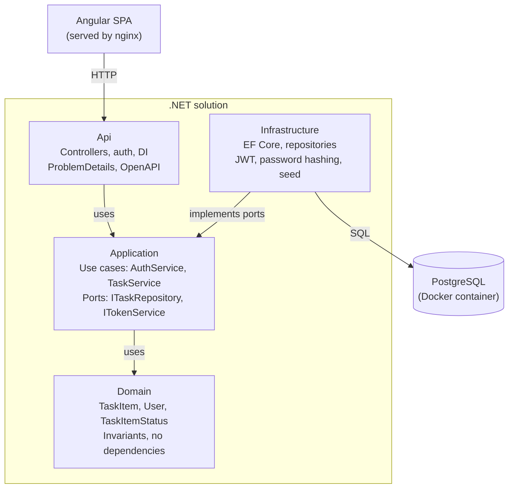

# Implementation Plan — Task Manager (.NET + Angular)

Technical exercise: full-stack task management application with ASP.NET Core Web API, Clean Architecture, PostgreSQL, Docker, Testcontainers and Angular.

---

## 1. Executive summary

The project implements **a single domain — personal task management (Task Manager)** — which serves both the main exercise and the Generative AI section of the brief. The same codebase is used for both, so the AI-assisted development section describes the real process used to build this application rather than a separate exercise.

Key decisions:

- **Backend:** .NET 10 (LTS), ASP.NET Core with **Controllers** (matching the "ASP.NET MVC, Web API" requirement), Clean Architecture in four projects (Domain, Application, Infrastructure, Api).
- **Database:** PostgreSQL in a container, accessed through EF Core with migrations and seed data.
- **Authentication:** JWT Bearer; passwords hashed with PBKDF2 via `PasswordHasher<T>`.
- **Two APIs:** Auth API (`/api/auth`) and Tasks API (`/api/tasks`) in the same host, each with its own OpenAPI document — the decision is recorded in an ADR.
- **Tests:** Test-Driven Development with xUnit; unit tests with NSubstitute; integration tests with **Testcontainers** (real PostgreSQL) and `WebApplicationFactory`; architecture tests with NetArchTest.
- **Frontend:** Angular (current stable version, v22) with standalone components, signals, typed reactive forms, functional interceptors and guards.
- **Execution:** `docker compose up --build` starts the database, API and frontend with demo data and credentials.
- **Process:** Spec-Driven Development (spec → design docs and ADRs → tasks → implementation), with Test-Driven Development in every task, and Conventional Commits showing the test-first cycle.
- **AI tooling:** `CLAUDE.md` + subagents in `.claude/agents/` working in isolated git worktrees, orchestrated by the main session.

Guiding principle: **defensible simplicity**. Every component has a reason that can be explained in one sentence. Patterns that the scope does not justify (full CQRS, event sourcing, microservices) are deliberately left out.

---

## 2. Methodology: SDD, Technical Design Documents and TDD

The three methodologies do not compete; they work at different levels. **Spec-Driven Development (SDD)** is the workflow for the whole project; the **Technical Design Document** is the artifact of the design step; **Test-Driven Development (TDD)** is the technique used inside each task, and unit tests are its direct output.



Traceability: acceptance criterion → design doc section → task → test → commit.

| Methodology | Question it answers | Artifact | Location | When |
| --- | --- | --- | --- | --- |
| SDD — Spec step | What are we building and why? | User story, acceptance criteria, out of scope | `docs/spec/user-story.md` | Phase 0, first |
| Technical Design Document | How will each feature be built? | One design doc per feature | `docs/design/DD-0N-*.md` | Phase 0, after the spec |
| ADR | Which decision did we make and what did we discard? | One record per decision | `docs/adr/` | Together with the design docs |
| SDD — Tasks step | Into which independent parts do we split the design? | One file per task | `docs/tasks/T*.md` | End of Phase 0 |
| Test-Driven Development | How do we guarantee each part works? | Unit tests written before the code | `backend/tests/`, `*.spec.ts` | Phases 1 to 3, in every task |
| Integration tests | Does the design work with a real database and HTTP? | Tests with Testcontainers | `backend/tests/*IntegrationTests` | Phases 2 and 3 |

Planned design docs (one per feature, short, 1 to 2 pages):

- `DD-01-authentication.md` — registration, login, JWT, password hashing, Auth API.
- `DD-02-task-management.md` — domain model, rules, Tasks API, persistence, task ownership.
- `DD-03-frontend.md` — routes, screens, signal-based store, API integration.
- `DD-04-runtime-and-quality.md` — Docker, seed, testing strategy, CI.

Technical Design Document template (`docs/design/DD-00-template.md`):

```markdown
# DD-0N — Feature name

- Status: Approved
- Spec: docs/spec/user-story.md (acceptance criteria 1, 2, 9)
- Related ADRs: ADR-0004, ADR-0005

## 1. Goal and scope
What this feature delivers. What is explicitly out of scope.

## 2. Proposed solution
How it works end to end (a short flow or sequence).

## 3. Contracts
Endpoints, DTOs, interfaces (ports) and error cases.

## 4. Data model
Tables, fields, constraints, indexes.

## 5. Business rules and validation
Where each rule lives (Domain or Application).

## 6. Testing approach
Which rules get unit tests, which flows get integration tests.

## 7. Risks and open questions

## 8. Task breakdown
T20 — ..., T22 — ... (links to docs/tasks/)
```

Section 8 is the bridge to the SDD Tasks step, and section 6 is the bridge to Test-Driven Development: each task inherits from it the list of tests to write first.

ADR vs. design doc: an ADR records **one decision** and the discarded alternatives; a design doc describes **an entire feature** and references the ADRs it follows. A design doc usually produces two or three ADRs.

Naming convention: in this repository **TDD always means Test-Driven Development**. Technical Design Documents are called **design docs** (folder `docs/design/`, prefix `DD-`) to avoid ambiguity between the two acronyms.

---

## 3. Requirements traceability

Each requirement of the brief has a concrete answer and a place in the repository.

| Requirement | How it is met | Location |
| --- | --- | --- |
| Informal user story | User story + acceptance criteria for the Task Manager | `docs/spec/user-story.md` |
| Database with a data table + a users table | PostgreSQL with `tasks` and `users` tables | `Infrastructure/Persistence` |
| Primary key + at least two other fields | `tasks`: Id, Title, Description, Status, DueDate, UserId, CreatedAt, UpdatedAt | EF Core migrations |
| Web API with CRUD | `TasksController`: GET list, GET by id, POST, PUT, DELETE | `Api/Controllers` |
| Appropriate verbs, parameters and return values | 200/201/204/400/401/404/409, `Location` header, ProblemDetails | API contract (section 7) |
| Second API: user creation, login, authorized and non-authorized endpoints | `AuthController`: register, login, status (public), `me` (authorized); separate OpenAPI document | `Api/Controllers` |
| Data access layer | Specific repositories on EF Core behind Application interfaces | `Infrastructure` |
| Business logic layer independent of data and API | Application + Domain projects with no reference to EF Core or ASP.NET | `Domain`, `Application` |
| Unit tests for all components | Domain, Application, Controllers (unit); repositories and API (integration) | `tests/` |
| Frontend framework | Angular, consuming the API | `frontend/` |
| Responsive and user-friendly | Angular Material + flexible layout, tested at mobile width | `frontend/` |
| CRUD in the frontend | List, create, edit, delete tasks, with status filters | `features/tasks` |
| Structured code | `core`, `shared`, `features` folders; state in signal-based services | `frontend/src/app` |
| README with setup instructions | Prerequisites, `docker compose up`, credentials, how to run tests | `README.md` |
| Seeded data and credentials | Demo user + ~8 tasks in different statuses | Seed in Infrastructure |
| GenAI: prompt, generated code, validation | Dedicated folder with prompt, sample and review log | `docs/genai/` |
| No browser console warnings (desired) | `track` in every `@for`, no 404/CORS errors, production build | Delivery checklist |

Two interpretations are recorded in ADRs: (1) the "second API" is a separate set of endpoints with its own OpenAPI document in the same host, and (2) "unit tests for the data access layer" are integration tests against a real PostgreSQL instance, because mocking EF Core tests the mock, not the data access.

---

## 4. Domain and user story (Spec)

In Spec-Driven Development this section is the **spec**: it lives in `docs/spec/user-story.md` and describes what and why, never how. The how lives in the design docs (`docs/design/`).

The domain is **personal task management**, which is also the system requested in the Generative AI section of the brief (title, description, status, due_date, associated with a user).

User story:

> **As a** busy professional, **I want to** register, log in and manage my own tasks with a title, description, status and due date, **so that** I can track what I need to do and what is overdue, without seeing anyone else's tasks.

Acceptance criteria (each one becomes at least one test):

1. I can register with name, email and password; a duplicate email is rejected (409).
2. I can log in and receive a token; wrong credentials return 401 with a generic message.
3. I can only see, edit and delete my own tasks; another user's task returns 404 (its existence is not revealed).
4. Title is required (3 to 100 characters); description has at most 1000 characters.
5. On creation, the due date cannot be in the past.
6. Possible statuses: `Todo`, `InProgress`, `Done`. A `Done` task can be reopened to `Todo`.
7. The list can be filtered by status and is paginated, ordered by due date.
8. A task that is not done and whose due date has passed is shown as overdue (`isOverdue`).
9. Without a token, every task endpoint returns 401.

Rules 4, 5, 6 and 8 live in the **Domain** (entity invariants). Rules 1, 2 and 3 live in the **Application** (use cases).

Out of scope (listed under "Future improvements" in the README): categories, task sharing, attachments, notifications, refresh tokens.

---

## 5. Architecture and solution structure

The solution follows Clean Architecture with four projects and one rule: **dependencies always point inward**. Domain knows nothing; Application knows only Domain; Infrastructure and Api know Application. Api is the only project that knows all others, because it is the *composition root* where dependency injection is wired.



Api and Infrastructure sit at the edges and depend on Application; Domain, at the center, depends on nothing — and the architecture tests guarantee it stays that way.

Responsibilities of each layer:

- **Domain** — entities (`User`, `TaskItem`), the `TaskItemStatus` enum, invariants and domain exceptions. No NuGet packages.
- **Application** — use cases (`TaskService`, `AuthService`), input and output DTOs, validators, port interfaces (`ITaskRepository`, `IUserRepository`, `IPasswordHasher`, `ITokenService`, `ICurrentUser`). Uses .NET `TimeProvider` for testable dates. There is no `IUnitOfWork`: the EF Core `DbContext` already is the unit of work.
- **Infrastructure** — `AppDbContext`, EF Core configurations (Fluent API), repositories, migrations, seed, JWT and password hashing implementations.
- **Api** — controllers, authentication setup, global error handling, OpenAPI, CORS, health checks, `Program.cs`.

The entity is named `TaskItem` instead of `Task` to avoid clashing with `System.Threading.Tasks.Task`.

Repository structure:

```text
task-manager/
├── CLAUDE.md                       # project instructions for AI tooling
├── README.md
├── docker-compose.yml
├── .env.example
├── .editorconfig
├── Directory.Build.props           # nullable, warnings as errors, analyzers
├── Directory.Packages.props        # central NuGet package versions
├── TaskManager.sln
├── .claude/                        # Claude Code configuration (see section 15)
├── docs/
│   ├── spec/                       # SDD step 1: user story and acceptance criteria
│   ├── design/                     # Technical Design Documents (DD-01 to DD-04)
│   ├── adr/                        # architecture decision records
│   ├── tasks/                      # SDD step 3: one specification per task
│   ├── genai/                      # Generative AI section deliverable
│   ├── architecture.md             # overview with diagram
│   └── api.md
├── backend/
│   ├── src/
│   │   ├── TaskManager.Domain/
│   │   ├── TaskManager.Application/
│   │   ├── TaskManager.Infrastructure/
│   │   └── TaskManager.Api/
│   ├── tests/                      # Test-Driven Development: unit + integration
│   │   ├── TaskManager.Domain.UnitTests/
│   │   ├── TaskManager.Application.UnitTests/
│   │   ├── TaskManager.Api.UnitTests/
│   │   ├── TaskManager.Infrastructure.IntegrationTests/
│   │   ├── TaskManager.Api.IntegrationTests/
│   │   └── TaskManager.ArchitectureTests/
│   └── Dockerfile
└── frontend/
    ├── src/app/
    ├── nginx.conf
    └── Dockerfile
```

Why not CQRS with MediatR, vertical slices or microservices: the domain has two entities and nine rules. Explicit application services keep the flow readable from the controller to the database in three hops, which makes the code easy to review.

---

## 6. Data model and database

The choice is **PostgreSQL 18 in a container with EF Core** (Npgsql provider). A relational model fits naturally (a task belongs to a user, FK with index), migrations give a versioned history of the schema, and EF Core + PostgreSQL is a well-established combination in the .NET ecosystem.

`users` table:

| Column | Type | Rules |
| --- | --- | --- |
| `id` | uuid | PK, generated by the application (`Guid.CreateVersion7()`, sortable) |
| `name` | varchar(100) | required |
| `email` | varchar(254) | required, unique, stored in lowercase |
| `password_hash` | varchar(500) | required, never exposed by the API |
| `created_at` | timestamptz | required |

`tasks` table:

| Column | Type | Rules |
| --- | --- | --- |
| `id` | uuid | PK, Guid v7 |
| `user_id` | uuid | FK to `users.id`, `ON DELETE CASCADE`, indexed |
| `title` | varchar(100) | required |
| `description` | varchar(1000) | optional |
| `status` | varchar(20) | `Todo`, `InProgress`, `Done` (enum stored as text, readable in the database) |
| `due_date` | date | required |
| `created_at` | timestamptz | required |
| `updated_at` | timestamptz | required |

A composite index `(user_id, status, due_date)` covers the main query: list my tasks filtered by status and ordered by due date.

Data access practices:

- Configuration through `IEntityTypeConfiguration<T>` (one class per entity), never EF attributes in the Domain.
- `snake_case` names through a convention (`EFCore.NamingConventions` package), the PostgreSQL standard.
- `AsNoTracking()` on read queries; pagination with `Skip/Take` and a total count.
- Every task query filters by `user_id` inside the repository — the ownership rule does not depend on the controller remembering it.
- Optional optimistic concurrency using PostgreSQL's `xmin` system column.

Demo seed (runs at startup in the Development environment, idempotent):

- User `demo@taskmanager.local` / password `Demo@12345`.
- Second user `other@taskmanager.local` / `Other@12345`, to demonstrate that one user cannot see the other's tasks.
- About 8 tasks for the demo user, covering the three statuses and at least one overdue task.

Migrations are applied automatically at startup only in Development (`Database.MigrateAsync()`); for production, the README documents `dotnet ef migrations bundle`.

---

## 7. API contract

Two APIs in the same host, each with its own controller and OpenAPI document (`auth-v1` and `tasks-v1`), shown separately in the Scalar UI. All error responses follow **ProblemDetails (RFC 9457)**, with an `errors` field for validation failures.

Auth API — `/api/auth`:

| Verb | Route | Auth | Body / parameters | Success | Errors |
| --- | --- | --- | --- | --- | --- |
| POST | `/api/auth/register` | public | `{ name, email, password }` | 201 + `{ id, name, email }` | 400 validation, 409 email already exists |
| POST | `/api/auth/login` | public | `{ email, password }` | 200 + `{ accessToken, expiresAt, user }` | 400, 401 invalid credentials |
| GET | `/api/auth/me` | **JWT** | — | 200 + `{ id, name, email }` | 401 |
| GET | `/api/auth/status` | public | — | 200 + `{ status, version }` | — |

`/me` and `/status` are the authorized and non-authorized endpoint pair required by the brief.

Tasks API — `/api/tasks` (all require JWT):

| Verb | Route | Body / parameters | Success | Errors |
| --- | --- | --- | --- | --- |
| GET | `/api/tasks` | query `status`, `page`, `pageSize` (max 50) | 200 + `{ items, page, pageSize, totalCount }` | 400, 401 |
| GET | `/api/tasks/{id}` | `guid` id in the route | 200 + `TaskResponse` | 401, 404 |
| POST | `/api/tasks` | `{ title, description, dueDate, status? }` | 201 + `Location` + `TaskResponse` | 400, 401 |
| PUT | `/api/tasks/{id}` | `{ title, description, dueDate, status }` (full replacement) | 200 + `TaskResponse` | 400, 401, 404 |
| DELETE | `/api/tasks/{id}` | — | 204 | 401, 404 |

`TaskResponse` = `{ id, title, description, status, dueDate, isOverdue, createdAt, updatedAt }`. Entities and `userId` are never returned — DTOs isolate the contract from the internal model.

Authentication and security:

- JWT Bearer signed with HMAC-SHA256; the key is read from an environment variable (`Jwt__Key`), never from code. 60-minute expiration; claims `sub` (user id), `email`, `name`.
- `ICurrentUser` reads `sub` from the `HttpContext` and is injected into the services — the `userId` never comes from the request body.
- Password hashing with ASP.NET Core Identity's `PasswordHasher<T>` (PBKDF2 with salt), behind the Application's `IPasswordHasher` interface.
- Password policy: at least 8 characters, with a letter and a number.
- Generic login message ("Invalid email or password") so registered emails are not revealed.
- Another user's task returns 404, not 403, for the same reason.
- Built-in rate limiting (`AddRateLimiter`) on the login endpoint.
- CORS restricted to the frontend origin.

Refresh tokens are explicitly out of scope and listed as a future improvement.

---

## 8. Design patterns and good practices

Few patterns, each with a clear reason:

| Pattern | Where | Why |
| --- | --- | --- |
| Dependency Inversion / Ports & Adapters | Interfaces in Application, implementations in Infrastructure | Business rules testable without a database; Application independent of the data layer, as the brief requires |
| Repository | `ITaskRepository`, `IUserRepository` — specific, no generic repository | It is the data access layer requested in the brief; keeps EF Core out of Application, allows testing use cases with mocks and centralizes the per-user filter |
| Unit of Work | The `AppDbContext` itself, without an `IUnitOfWork` interface | EF Core already implements the pattern; each repository write calls `SaveChangesAsync`, and each use case changes a single aggregate |
| Rich Domain Model + Factory Method | `TaskItem.Create(...)`, `task.Update(...)`, `task.ChangeStatus(...)` | Private setters; an object never exists in an invalid state |
| Result pattern | Service return type: `Result<T>` with a typed `Error` (Validation, NotFound, Conflict, Unauthorized) | Expected failures without exceptions; the controller translates to HTTP in a single place |
| DTO / manual mapping | `TaskResponse.FromEntity(task)` | Explicit contract, no mapping magic |
| Options pattern | `JwtOptions` validated at startup (`ValidateOnStart`) | Typed configuration; the app does not start with a missing JWT key |
| Global exception handler | `IExceptionHandler` + `AddProblemDetails()` | Unexpected errors become 500 ProblemDetails, with no stack trace leaked |

How errors flow: invalid input is stopped by the validator (FluentValidation) in Application; a violated business rule returns a `Result` with an error; a broken invariant inside the Domain throws a `DomainException` (last line of defense), converted to 400 by the global handler.

Code quality practices:

- `Directory.Build.props` with `<Nullable>enable</Nullable>`, `<TreatWarningsAsErrors>true</TreatWarningsAsErrors>` and .NET analyzers enabled.
- `Directory.Packages.props` (Central Package Management) — one version per package across the repository.
- `.editorconfig` + `dotnet format` verified in CI.
- `async` end to end, with `CancellationToken` passed down to EF Core.
- Injected `TimeProvider` instead of `DateTime.UtcNow` — makes the "due date cannot be in the past" rule testable.
- `sealed` on classes not designed for inheritance; `record` for DTOs.
- Structured logging with `ILogger` (passwords and tokens are never logged).
- `/health` health check that verifies the database, used by `docker compose`.

Libraries:

| Use | For | Note |
| --- | --- | --- |
| FluentValidation | DTO validation | Apache 2.0 license |
| Npgsql.EntityFrameworkCore.PostgreSQL | EF Core provider | — |
| Microsoft.AspNetCore.Authentication.JwtBearer | Authentication | Built in |
| Scalar.AspNetCore | OpenAPI UI | With the built-in `Microsoft.AspNetCore.OpenApi` |
| xUnit, NSubstitute, Shouldly | Tests | See section 9 |

MediatR, AutoMapper and FluentAssertions (v8+) are deliberately not used: all three moved to commercial licensing for business use, and none is needed at this project's size.

---

## 9. Testing strategy

In this plan, **TDD always means Test-Driven Development**. Unit tests are the direct output of each task's red-green-refactor cycle; integration tests verify, with a real database and HTTP, what section 6 (Testing approach) of each design doc promised.

Each acceptance criterion of the user story has a test with the same business-language name, and the Git history shows the test-first cycle. There are six test projects:

| Project | Type | What it covers | Tools |
| --- | --- | --- | --- |
| `Domain.UnitTests` | Unit | `TaskItem` and `User` invariants, status transitions, `IsOverdue` | xUnit, Shouldly |
| `Application.UnitTests` | Unit | Use cases and validators: duplicate email, task ownership, invalid login | xUnit, NSubstitute, `FakeTimeProvider` |
| `Api.UnitTests` | Unit | Controllers: `Result` → HTTP status mapping, `Location` on 201 | xUnit, NSubstitute |
| `Infrastructure.IntegrationTests` | Integration | Repositories, EF mappings, unique email index, per-user filter, migrations apply | Testcontainers.PostgreSql, Respawn |
| `Api.IntegrationTests` | End-to-end integration | Real HTTP: register → login → CRUD; 401 without token; 404 on another user's task | `WebApplicationFactory`, Testcontainers |
| `ArchitectureTests` | Architecture | Domain references nothing; Application references neither Infrastructure nor ASP.NET | NetArchTest.Rules |

The architecture test project **proves** the Clean Architecture dependency rules instead of only stating them.

Integration test setup with Testcontainers:

1. A `PostgresFixture` implements `IAsyncLifetime`, starts a `postgres:18-alpine` container and applies the migrations once.
2. An xUnit *collection fixture* shares the container across test classes — one container per run, not one per test.
3. `Respawn` cleans the tables between tests (fast, without recreating the database).
4. In the API tests, a `CustomWebApplicationFactory` overrides the connection string with the container's and sets a test JWT key.
5. An `AuthenticateAsync()` helper registers and logs in a user and returns an `HttpClient` with the `Authorization` header set.

Prerequisite: Docker running locally and in CI. GitHub Actions `ubuntu-latest` runners include Docker, so integration tests run in the pipeline without extra setup.

Conventions:

- Naming: `Method_Scenario_ExpectedResult`, e.g. `Create_WhenDueDateIsInThePast_ReturnsValidationError`.
- Visible Arrange / Act / Assert structure, one behavior per test.
- *Test data builders* (`TaskItemBuilder`) instead of repeated constructors.
- Coverage with `coverlet.collector` + ReportGenerator; target of 80% or more for Domain and Application, summarized in the README.

How Test-Driven Development shows in the history:

```text
test(domain): TaskItem rejects due date in the past        <- red
feat(domain): validate due date on TaskItem.Create         <- green
refactor(domain): extract Guard helpers                    <- refactor
```

Frontend: unit tests with Vitest (the default runner in recent Angular CLI versions) for services, guard, interceptor and the task form. An end-to-end Playwright test covering login → create → edit → delete is optional.

---

## 10. Angular frontend

The current stable version (Angular 22, released June 2026) with Angular Material, and the modern practices the CLI already generates by default: standalone components, signals, the new control flow (`@if`, `@for`) and a zoneless application.

Folder structure:

```text
frontend/src/app/
├── app.config.ts            # provideRouter, provideHttpClient(withInterceptors(...))
├── app.routes.ts            # routes with loadComponent (lazy loading)
├── core/
│   ├── auth/
│   │   ├── auth.service.ts      # login, register, logout, currentUser (signal)
│   │   ├── auth.guard.ts        # functional CanActivateFn
│   │   ├── auth.interceptor.ts  # adds the Bearer token
│   │   └── token.storage.ts
│   ├── http/
│   │   └── error.interceptor.ts # 401 -> logout; ProblemDetails -> message
│   └── models/                  # types mirroring the API DTOs
├── shared/
│   └── ui/                      # status-badge, confirm-dialog, empty-state, loading
├── layout/
│   └── shell/                   # toolbar + router-outlet
└── features/
    ├── auth/
    │   ├── login/
    │   └── register/
    └── tasks/
        ├── data-access/
        │   ├── tasks.api.ts     # HTTP only
        │   └── tasks.store.ts   # signal-based state
        ├── task-list/
        ├── task-form/           # create and edit
        └── components/
            ├── task-card/
            └── task-filters/
```

Each component folder holds `name.component.ts` (logic), `name.component.html` (template) and, when the component has styles, `name.component.scss`.

State management: one *store* per feature, implemented as a service with `signal()` and `computed()` — no NgRx. `TasksStore` holds `tasks`, `filter`, `loading` and `error`, exposes `load()`, `create()`, `update()` and `remove()`, and components only read signals. `TasksApi` only performs HTTP. The component → store → api separation keeps components and state cleanly organized.

Screens:

1. **Login** and **Register** — typed reactive forms, per-field validation messages, server errors displayed.
2. **Task list** — status filter, pagination, status badge, overdue highlight; table on desktop and cards on mobile (`BreakpointObserver`).
3. **Task form** — the same component for create and edit, with a datepicker and validation mirroring the backend rules.
4. **Delete** — confirmation dialog, then a success snackbar.

Practices:

- `ChangeDetectionStrategy.OnPush` and `inject()` in every component.
- Functional interceptors and guards (`HttpInterceptorFn`, `CanActivateFn`).
- Relative API URL (`/api`): in development through the `ng serve` `proxy.conf.json`, in Docker through the nginx proxy. No CORS issues in the browser.
- Loading, empty and error states on every list.
- Basic accessibility: `label` on every field, Material theme contrast, keyboard navigation.
- Linting with `angular-eslint` and formatting with Prettier.

Token storage: `sessionStorage`, recorded in an ADR with its trade-off (an `httpOnly` cookie is safer against XSS but requires CSRF protection and more configuration).

Clean browser console: `track` in every `@for`, production build in Docker, favicon present, no 404 or CORS requests, no `NG0` errors.

---

## 11. Docker and local execution

A single command — `docker compose up --build` — starts everything with demo data. .NET and Node do not need to be installed to run the application.

`docker-compose.yml` services:

| Service | Image | Local port | Details |
| --- | --- | --- | --- |
| `db` | `postgres:18-alpine` | 5432 | Named volume, `pg_isready` healthcheck |
| `api` | Build from `backend/Dockerfile` | 5080 | `depends_on: db: condition: service_healthy`; healthcheck on `/health` |
| `web` | Build from `frontend/Dockerfile` | 4200 | nginx serving the build and proxying `/api` to `api:8080` |

Compose outline (reference for the implementation, not final code):

```yaml
services:
  db:
    image: postgres:18-alpine
    environment:
      POSTGRES_DB: taskmanager
      POSTGRES_USER: ${POSTGRES_USER}
      POSTGRES_PASSWORD: ${POSTGRES_PASSWORD}
    volumes: [pgdata:/var/lib/postgresql]
    healthcheck:
      test: ["CMD-SHELL", "pg_isready -U ${POSTGRES_USER} -d taskmanager"]
      interval: 5s
      retries: 10
  api:
    build: ./backend
    environment:
      ASPNETCORE_ENVIRONMENT: Development
      ConnectionStrings__Default: Host=db;Database=taskmanager;Username=${POSTGRES_USER};Password=${POSTGRES_PASSWORD}
      Jwt__Key: ${JWT_KEY}
    ports: ["5080:8080"]
    depends_on:
      db: { condition: service_healthy }
  web:
    build: ./frontend
    ports: ["4200:80"]
    depends_on: [api]
volumes:
  pgdata:
```

Dockerfiles:

- **Backend** — multi-stage: `mcr.microsoft.com/dotnet/sdk:10.0` for `restore` and `publish`, `mcr.microsoft.com/dotnet/aspnet:10.0` to run. The official images include the non-root `app` user; use `USER app`. Copy the `.csproj` files and restore first, then the source — layer caching speeds up rebuilds.
- **Frontend** — multi-stage: `node:22-alpine` runs `npm ci` and `ng build`; `nginx:alpine` serves `dist/` with `try_files $uri /index.html` (SPA routes) and `location /api/ { proxy_pass http://api:8080; }`.
- `.dockerignore` in both (exclude `bin/`, `obj/`, `node_modules/`, `.angular/`).

Variables and secrets:

- `.env.example` is committed with demo values; `.env` is in `.gitignore`. The README instructs copying one to the other.
- The demo JWT key has at least 32 characters and never appears in `appsettings.json`.

Development without the full Docker stack: `docker compose up db` for the database only, `dotnet run` for the Api and `ng serve` with the proxy for the frontend. Both modes are documented in the README.

The Node image tag (active LTS) is confirmed at implementation time.

---

## 12. Architecture Decision Records (ADRs)

About a dozen short ADRs (half a page each) in `docs/adr/`. They guide the AI agents (which read the decisions before coding), keep independent tasks consistent with each other, and document the design choices.

| No. | Title | Decision |
| --- | --- | --- |
| 0001 | Record architecture decisions | Use ADRs in a simplified MADR format |
| 0002 | Clean Architecture with four projects | Domain, Application, Infrastructure, Api; dependencies point inward; specific repositories as the data access layer |
| 0003 | PostgreSQL with EF Core | PostgreSQL in a container; relational model and versioned migrations |
| 0004 | Two APIs in a single host | Auth API and Tasks API as separate controllers and OpenAPI documents; two hosts would add cost without benefit at this scope |
| 0005 | JWT bearer authentication | Short-lived JWT, PBKDF2, no refresh token (scope) |
| 0006 | Result pattern for expected failures | `Result<T>` in Application; exceptions only for the unexpected |
| 0007 | No MediatR, AutoMapper, FluentAssertions or IUnitOfWork | Explicit services, manual mapping and DbContext as the unit of work; commercial licenses and unnecessary complexity |
| 0008 | Testing strategy | Pyramid: unit + integration with Testcontainers; no EF InMemory |
| 0009 | Angular with signal-based stores | Signals instead of NgRx; Angular Material for responsiveness |
| 0010 | Token storage in the browser | `sessionStorage`, with documented trade-offs |
| 0011 | Spec-driven, AI-assisted workflow | SDD with design docs, CLAUDE.md, subagents, worktrees, mandatory human review |

ADR template (`docs/adr/0000-template.md`):

```markdown
# NNNN — Short title in the imperative

- Status: Accepted
- Date: 2026-10-24

## Context
Which problem or force motivated the decision (3 to 5 lines).

## Decision
What was decided, in one or two sentences.

## Alternatives considered
- Alternative A — why not.
- Alternative B — why not.

## Consequences
- Positive: ...
- Negative / accepted trade-offs: ...
```

Rule of thumb: if "Alternatives considered" cannot be filled in, the decision probably does not need an ADR. ADRs are written **before** implementing the corresponding part, which is what makes them useful to the agents.

---

## 13. Phased backlog with independent tasks

Parallel work is enabled by **Phase 0 contracts**: once the interfaces, DTOs and entity shapes are on `main`, each track (domain, infrastructure, API, frontend) works against those contracts without waiting for the others. There are 5 phases and 22 tasks; each task fits in one working session and ends with green tests and a pull request.

| ID | Phase | Task | Depends on | Agent |
| --- | --- | --- | --- | --- |
| T00 | 0 Foundation | Solution, projects, references, `Directory.Build.props`, CPM, `.gitignore`, CI (build + test) | — | orchestrator |
| T01 | 0 Foundation | `spec/user-story.md`, design docs DD-01 to DD-04, ADRs 0001–0011, `CLAUDE.md`, `.claude/` folder | T00 | developer + orchestrator |
| T02 | 0 Foundation | Contracts: Application interfaces, DTOs, `Result`/`Error`, entity shapes, `docs/api.md` | T01 | orchestrator |
| T03 | 0 Foundation | Architecture tests (NetArchTest) | T02 | test-engineer |
| T10 | 1 Core | Domain: `TaskItem` and `User` behavior with Test-Driven Development | T02 | backend-domain |
| T11 | 1 Core | Infrastructure base: `AppDbContext`, EF configurations, initial migration, `PostgresFixture` | T02 | backend-infra |
| T12 | 1 Core | Frontend: Angular app, Material, routes, shell, proxy, models | T02 | frontend |
| T20 | 2 Use cases | `AuthService` + validators (TDD with mocks) | T10 | backend-app |
| T21 | 2 Use cases | `TaskService` + validators, ownership rule | T10 | backend-app |
| T22 | 2 Use cases | Repositories (DbContext as the unit of work) + tests with Testcontainers | T11 | backend-infra |
| T23 | 2 Use cases | JWT, password hashing, demo seed | T11 | backend-infra |
| T24 | 2 Use cases | Frontend auth: login, register, interceptor, guard | T12 | frontend |
| T30 | 3 API | `Program.cs`: DI, auth, ProblemDetails, two OpenAPI documents, CORS, health, rate limiting | T20–T23 | backend-api |
| T31 | 3 API | `AuthController` + unit tests | T30 | backend-api |
| T32 | 3 API | `TasksController` + unit tests | T30 | backend-api |
| T33 | 3 API | End-to-end API integration tests | T31, T32 | test-engineer |
| T34 | 3 API | Frontend tasks: list, filters, form, delete, responsive | T24, T32 | frontend |
| T40 | 4 Delivery | api and web Dockerfiles, full compose, smoke test | T33, T34 | orchestrator |
| T41 | 4 Delivery | README, `architecture.md` with diagram, coverage report | T40 | docs-writer |
| T42 | 4 Delivery | Generative AI deliverable in `docs/genai/` | T33 | developer + docs-writer |
| T43 | 4 Delivery | Final review: code-reviewer, requirements checklist, clean console | T41, T42 | code-reviewer + developer |
| T44 | 4 Delivery | Presentation rehearsal and demo recording | T43 | developer |

From the SDD perspective, this backlog is the Tasks step: each task comes from section 8 of a design doc and is implemented with Test-Driven Development. DD-01 produces T20, T23 and T31; DD-02 produces T10, T11, T21, T22 and T32; DD-03 produces T12, T24 and T34; DD-04 produces T00, T03, T33 and T40.

Phase 1 runs 3 tracks in parallel; Phase 2, up to 4. Phases 0 and 4 are sequential by nature: they define and integrate.

Each task has its own file in `docs/tasks/` — the specification handed to an agent. Template (`docs/tasks/T21-task-service.md`):

```markdown
# T21 — TaskService (Application)

## Goal
Implement CRUD use cases for tasks, enforcing ownership.

## Context
- Spec: docs/spec/user-story.md — acceptance criteria 3, 4, 5, 7
- Design: docs/design/DD-02-task-management.md — sections 3, 5 and 6
- ADRs: ADR-0002, ADR-0006
- Contracts: ITaskRepository, ICurrentUser (already on main)

## Scope — files you may create or change
- backend/src/TaskManager.Application/Tasks/**
- backend/tests/TaskManager.Application.UnitTests/Tasks/**

## Out of scope
- Controllers, EF Core, anything in Infrastructure or Api

## Tests to write first (red) — from DD-02, section 6
- Create_WhenTitleIsEmpty_ReturnsValidationError
- GetById_WhenTaskBelongsToAnotherUser_ReturnsNotFound
- List_FiltersByStatus_AndPaginates
- ...

## Definition of done
- [ ] All tests above written first, then passing (Test-Driven Development)
- [ ] dotnet build with zero warnings; dotnet format clean
- [ ] Architecture tests still green
- [ ] Conventional commits: test → feat → refactor
- [ ] PR description lists what was done and any decision taken
```

The **Scope** section prevents merge conflicts between parallel agents: two tasks in the same phase never list the same files.

---

## 14. Multi-agent orchestration

The model is **one orchestrating session + specialized subagents, each in its own git worktree**, with every merge approved by the developer. The main Claude Code session is the orchestrator: it reads the phase backlog and delegates each task to a subagent; subagents work in isolation on separate branches without touching each other's code.

Three levels, from simplest to most automated:

1. **Manual parallel sessions** — 2 or 3 Claude Code sessions, each in a worktree (`claude --worktree`), each given one file from `docs/tasks/`. The developer is the orchestrator.
2. **Orchestrator + subagents** (used from Phase 1) — the main session launches the subagents defined in `.claude/agents/`, with `isolation: worktree`, in the background. Each returns a summary; the `code-reviewer` reviews; the developer merges.
3. **Agent teams** — a Claude Code feature in which several sessions coordinate through a shared task list. Evaluated but not used, to keep control and reviewability.

Level 1 is used in Phase 0, level 2 in Phases 1 to 3, and manual control again in Phase 4.

Agents:

| Agent | Responsibility | Tools | Isolation |
| --- | --- | --- | --- |
| orchestrator (main session) | Reads the phase, delegates, integrates, handles shared files | All | main checkout |
| `backend-domain` | Entities and invariants with Test-Driven Development | Read, Edit, Write, Bash, Grep, Glob | worktree |
| `backend-app` | Use cases, validators, tests with mocks | same | worktree |
| `backend-infra` | EF Core, repositories, JWT, seed, Testcontainers | same | worktree |
| `backend-api` | Controllers, host configuration, controller tests | same | worktree |
| `frontend` | Angular: features, store, components, tests | same | worktree |
| `test-engineer` | Architecture tests and end-to-end integration tests | same | worktree |
| `code-reviewer` | Adversarial review of the diff against the ADRs and Definition of Done | Read, Grep, Glob, Bash (read-only) | not needed |
| `docs-writer` | README, `architecture.md`, API documentation | Read, Edit, Write, Grep, Glob | worktree |

Phase cycle:

1. The developer reviews and adjusts the phase's `docs/tasks/` files (generated from section 8 of the design docs — they are the contract with the agents).
2. The orchestrator launches one subagent per task, in parallel, each in its own worktree and branch (`feat/T21-task-service`).
3. Each subagent follows the Test-Driven Development cycle: write the failing test → `test:` commit → implement → green `dotnet test` → `feat:` commit → refactor → `refactor:` commit.
4. The `code-reviewer` analyzes each branch diff: architecture, security, naming, missing tests. Critical findings go back to the original agent.
5. **The developer** reads the diff and merges to `main`. No agent merges or pushes.
6. Green CI on `main` unlocks the next phase.

Example prompt for the orchestrator to start Phase 2:

```text
We are starting Phase 2. Read docs/tasks/T20, T21, T22, T23 and the ADRs they reference.
For each task, spawn the agent named in the backlog table, in the background, with
isolation in its own worktree and branch feat/<task-id>-<slug>. Give each agent only
its task file path and tell it to follow the TDD cycle and the Definition of Done.
Do not edit Program.cs, DependencyInjection.cs or the .sln yourself until all four finish.
When they finish, run the code-reviewer on each branch and give me one summary table:
task, branch, tests added, review findings, ready to merge (yes/no).
```

Safeguards:

- **Shared files** (`Program.cs`, `DependencyInjection.cs`, `.sln`, `app.routes.ts`) are reserved for the orchestrator, which adjusts them after the merges.
- **Subagents do not see the main conversation.** Everything they need must be in the task file, the design doc, the ADRs and `CLAUDE.md`.
- **Limited parallelism.** Three or four simultaneous agents is the most that can be reviewed with quality.
- **`.worktreeinclude`** at the root copies `.env` into each new worktree (worktrees do not include git-ignored files).
- **Testcontainers in parallel** works: each run starts its own container on a random port.
- **Cost:** implementation agents can use a lighter model, and the reviewer a more capable one.

---

## 15. AI tooling files in the repository

Organizing rule: **`CLAUDE.md` says how to work, `docs/` says what to build, `.claude/` configures the tool.** Almost everything is versioned in Git as part of the project; only personal files are git-ignored.

```text
task-manager/
├── CLAUDE.md                  # committed — project instructions, loaded every session
├── CLAUDE.local.md            # git-ignored — personal preferences (optional)
├── .worktreeinclude           # committed — ignored files to copy into worktrees (.env)
├── .mcp.json                  # committed — project MCP servers (optional)
├── docs/
│   ├── spec/                  # SDD: what and why — source of truth for scope
│   ├── design/                # Technical Design Documents — how each feature is built
│   ├── adr/                   # decisions — read by agents before coding
│   ├── tasks/                 # SDD: tasks — the "contract" of each agent
│   └── genai/                 # Generative AI section deliverable
└── .claude/
    ├── settings.json          # committed — team permissions and hooks
    ├── settings.local.json    # git-ignored — personal extra permissions
    ├── rules/                 # instructions loaded only for certain paths
    │   ├── dotnet.md          # paths: backend/**
    │   ├── dotnet-tests.md    # paths: backend/tests/** (Test-Driven Development conventions)
    │   └── angular.md         # paths: frontend/**
    ├── agents/                # one .md file per subagent
    │   ├── backend-domain.md
    │   ├── backend-app.md
    │   ├── backend-infra.md
    │   ├── backend-api.md
    │   ├── frontend.md
    │   ├── test-engineer.md
    │   ├── code-reviewer.md
    │   └── docs-writer.md
    └── skills/                # reusable workflows, invoked with /name
        ├── new-design-doc/SKILL.md     # SDD step 2: creates a DD from the spec
        ├── break-into-tasks/SKILL.md   # SDD step 3: generates docs/tasks from a DD
        ├── start-task/SKILL.md         # SDD step 4: starts a task
        ├── tdd-cycle/SKILL.md          # Test-Driven Development: red, green, refactor
        ├── new-adr/SKILL.md
        └── pre-submit-check/SKILL.md
```

What goes where:

| File | When it loads | Content |
| --- | --- | --- |
| `CLAUDE.md` | Start of every session and every subagent | Overview, build and test commands, architecture rules, Test-Driven Development flow, Git. Under 200 lines |
| `.claude/rules/*.md` | When the AI reads a file matching `paths:` | .NET, test or Angular conventions, without loading them for the other side |
| `.claude/agents/*.md` | When the subagent is invoked | Role, allowed tools, isolation, step-by-step work |
| `.claude/skills/*/SKILL.md` | When invoked with `/name` or matched to the task | Repeated procedures: start a task, create an ADR, delivery checklist |
| `.claude/settings.json` | Always, and it is **enforced** | Allowed and denied commands, hooks |

`CLAUDE.md` and `rules/` are guidance the model reads; `settings.json` (permissions and hooks) is enforced by the tool. Anything that must never happen (push, deleting folders, reading `.env`) goes in `settings.json`.

`CLAUDE.md`:

```markdown
# Task Manager — project instructions

Full-stack task manager for a technical interview. Clarity beats cleverness:
every change must be easy to explain in a code review.

## Read before coding (spec-driven)
- docs/spec/user-story.md — what and why: scope and acceptance criteria
- docs/design/ — the design doc of your feature: how it is built
- docs/adr/ — accepted decisions; do not contradict them without a new ADR
- The task file in docs/tasks/ you were given — your exact scope

## Commands
- Build: `dotnet build backend/TaskManager.sln`
- Unit tests: `dotnet test backend --filter "Category!=Integration"`
- All tests (Docker required): `dotnet test backend`
- Format: `dotnet format backend/TaskManager.sln`
- Frontend: `cd frontend && npm test` / `npm run lint` / `npm run build`
- Full stack: `docker compose up --build`

## Architecture rules
- Domain depends on nothing. Application depends only on Domain.
- Infrastructure and Api depend on Application. Never reference EF Core
  or ASP.NET from Domain or Application.
- Expected failures return Result<T>; exceptions only for the unexpected.
- Never return entities from controllers; use DTOs.
- Every task query filters by the current user inside the repository.

## Workflow
- Spec-driven: no code without a task file; no task without a design doc.
- In this repo "TDD" always means Test-Driven Development. Technical design
  documents are called design docs (DD-xx).
- Test-Driven Development: failing test → commit `test:` → make it pass →
  commit `feat:` → refactor.
- Conventional Commits. Small commits. Zero build warnings.
- Touch only files listed in your task's Scope section.
- If the design doc is wrong or incomplete, stop and report; do not improvise.
- Never push, never merge, never edit .env.

## Done means
- Tests written first and green, architecture tests green,
  `dotnet format` clean, and a short summary of what changed and why.
```

Subagent (`.claude/agents/backend-app.md`):

```markdown
---
name: backend-app
description: Implements Application-layer use cases and validators with Test-Driven Development. Use for docs/tasks files that target TaskManager.Application.
tools: Read, Edit, Write, Bash, Grep, Glob
isolation: worktree
skills:
  - tdd-cycle
---

You implement exactly one task file from docs/tasks/, given in your prompt.

1. Read the task file, the design doc sections and ADRs it lists, and the
   acceptance criteria it cites in docs/spec/user-story.md.
2. For each test listed under "Tests to write first": write it, run it, see it fail,
   commit with `test(app): ...`.
3. Write the minimum code to pass. Run
   `dotnet test backend/tests/TaskManager.Application.UnitTests`. Commit `feat(app): ...`.
4. Refactor with tests green. Commit `refactor(app): ...` if anything changed.
5. Never edit files outside the task's Scope. If you need a contract change or the
   design doc does not cover a case, stop and report it instead of deciding alone.
6. Finish with: files changed, tests added, decisions taken, open questions.
```

Reviewer (`.claude/agents/code-reviewer.md`):

```markdown
---
name: code-reviewer
description: Reviews a branch diff against the ADRs, CLAUDE.md and the task's Definition of Done. Use after any implementation task finishes.
tools: Read, Grep, Glob, Bash
---

You are a strict senior .NET and Angular reviewer. You never edit files.
Run `git diff main...HEAD` and review for: layer violations, missing ownership
checks, missing or weak tests, security (secrets, auth, input validation),
naming and readability, warnings. Report findings as Critical / Should fix /
Suggestion, each with file, line and a concrete fix.
```

Skill (`.claude/skills/start-task/SKILL.md`), used as `/start-task T21`:

```markdown
---
description: Starts a backlog task from docs/tasks by its ID, following TDD and the task's Definition of Done
disable-model-invocation: true
argument-hint: <task-id>
---

Open the file in docs/tasks/ whose name starts with $ARGUMENTS.
Summarize the goal, scope and tests to write first, then ask me to confirm
before writing any code. After confirmation, follow the tdd-cycle skill.
```

`.claude/settings.json`:

```json
{
  "permissions": {
    "allow": [
      "Bash(dotnet build *)", "Bash(dotnet test *)", "Bash(dotnet format *)",
      "Bash(dotnet ef *)", "Bash(npm run *)", "Bash(npm test *)",
      "Bash(docker compose *)", "Bash(git status)", "Bash(git diff *)",
      "Bash(git log *)", "Bash(git add *)", "Bash(git commit *)"
    ],
    "deny": [
      "Bash(git push *)", "Bash(rm -rf *)",
      "Read(./.env)", "Read(./**/.env)"
    ]
  }
}
```

Adoption order: `CLAUDE.md` and `settings.json` in Phase 0; agents before Phase 1; skills when the same instruction starts being repeated.

---

## 16. Generative AI section

Since the main project is itself a task manager, the Generative AI section is a **record of what actually happened** during development, not a separate exercise. It is organized in `docs/genai/`:

| File | Content | Brief item covered |
| --- | --- | --- |
| `01-prompt.md` | The prompt used to generate the Tasks API scaffold, with an explanation of each block | "write the prompt you would use" |
| `02-output-sample.md` | A representative excerpt of the **first, unedited AI output** (controller + service) | "show the output code" |
| `03-review-log.md` | Table: issue found → how it was detected → fix → commit | "validated / corrected" |
| `04-edge-cases.md` | How authentication, authorization, validation and edge cases were handled | "edge cases, authentication, validations" |
| `05-workflow.md` | SDD (spec → design docs → tasks), CLAUDE.md, subagents, worktrees, adversarial review — the process | Fluency with the tools |

Prompt (`01-prompt.md`), structured as role, context, constraints, criteria and output format:

```text
You are a senior .NET engineer. Generate a RESTful API for a task management system.

Context
- .NET 10, ASP.NET Core Web API with controllers, EF Core with PostgreSQL.
- Clean Architecture: Domain, Application, Infrastructure, Api projects.
- A User entity and JWT authentication already exist; the current user id
  comes from the `sub` claim via an ICurrentUser service.

Requirements
- TaskItem: Id (Guid), Title, Description, Status (Todo | InProgress | Done),
  DueDate, UserId, CreatedAt, UpdatedAt.
- Endpoints: GET /api/tasks (filter by status, paginated), GET /api/tasks/{id},
  POST /api/tasks, PUT /api/tasks/{id}, DELETE /api/tasks/{id}. All require auth.
- A user can only read or change their own tasks; another user's task returns 404.

Constraints
- Title required, 3-100 chars; description max 1000; due date not in the past on create.
- Return DTOs, never entities. Errors as ProblemDetails (RFC 9457).
- Correct status codes: 201 with Location on create, 204 on delete.
- Use TimeProvider, not DateTime.Now. Pass CancellationToken end to end.
- Do not use MediatR or AutoMapper.

Output
1. The files, grouped by project, with full paths.
2. xUnit tests for the service, written so they would fail without the implementation.
3. A list of assumptions you made and anything you were unsure about.
```

Rationale: the **context** prevents the AI from inventing an architecture; the **constraints** target the mistakes AI-generated code commonly makes; item 3 of the **output** forces the AI to expose uncertainty instead of hiding it.

Validation process for AI output:

1. **Builds with zero warnings** (`TreatWarningsAsErrors`) — catches invented or obsolete APIs.
2. **Tests written beforehand pass** — with Test-Driven Development, the test is the specification the AI must satisfy.
3. **Architecture tests pass** — catches dependencies pointing the wrong way.
4. **Adversarial review** by the `code-reviewer` subagent and then by the developer, with a security checklist.
5. **Manual testing** in Scalar and in the frontend, including error paths.

Checklist of typical flaws in AI-generated code (each one is checked; only issues actually observed are recorded in `03-review-log.md`):

- Queries without a per-user filter (IDOR-type authorization flaw) or `userId` taken from the request body.
- Entities returned directly by the controller, exposing internal fields.
- `DateTime.Now` instead of `TimeProvider`/UTC; dates compared in the wrong time zone.
- 200 instead of 201/204; missing `Location` header.
- Lists without pagination.
- Weak password hashing or a JWT key written in `appsettings.json`.
- Outdated packages or APIs (for example, an old Swagger package instead of the built-in OpenAPI support).
- `catch (Exception)` swallowing errors; missing `CancellationToken`.
- Tests that test the mock instead of the behavior.

---

## 17. README and delivery checklist

README structure:

1. **Title + one sentence** describing the project, and a screenshot of the task list.
2. **Quick start** — prerequisites (Docker), `cp .env.example .env`, `docker compose up --build`, URLs (app at `localhost:4200`, API and documentation at `localhost:5080/scalar`).
3. **Demo credentials** — the two seeded users, highlighted.
4. **Spec and design** — summary with links to `docs/spec/` and `docs/design/`.
5. **Architecture** — layer diagram, one line per project, link to the ADRs.
6. **API** — endpoint table (section 7) and how to authenticate in Scalar.
7. **Running tests** — unit and integration commands (with a note about Docker), coverage summary.
8. **Local development without Docker** — database in the container, API and Angular running locally.
9. **AI-assisted development** — link to `docs/genai/` and a short explanation of the `.claude/` folder.
10. **Requirements traceability** — the table from section 3.
11. **Future improvements** — refresh tokens, categories, sharing, observability, deployment.

Delivery checklist:

- [ ] Fresh clone in another folder + `docker compose up --build` works with no extra steps
- [ ] Login with the demo user works; the second user cannot see the first user's tasks
- [ ] Full CRUD in the frontend, on desktop and at mobile width
- [ ] Browser console free of errors and warnings
- [ ] `dotnet build` with no warnings; all tests green, including integration
- [ ] Architecture tests green
- [ ] No real secrets in the repository (`.env` outside Git; history checked for "password" and "key")
- [ ] Scalar shows both APIs separately, with authentication working
- [ ] All ADRs Accepted and consistent with the code
- [ ] `docs/genai/` complete, with real examples
- [ ] Readable commit history showing `test → feat → refactor`
- [ ] Green CI on the last commit, with a badge in the README
- [ ] Agent branches merged or removed; no `WIP` on `main`

---

## 18. Presentation outline and design FAQ

Presentation outline (about 20 minutes, followed by the code review):

| Block | Time | Content |
| --- | --- | --- |
| 1. Spec and design | 2 min | `docs/spec/user-story.md`: the story and criteria, then DD-02 showing how a criterion became a task and a test |
| 2. Architecture | 4 min | Layer diagram, solution structure, one ADR |
| 3. Live demo | 5 min | Login → list → create → edit → delete → mobile width → login as the other user → Scalar with 401 and 200 |
| 4. Code | 4 min | One complete flow: `TasksController.Create` → `TaskService` → `TaskItem.Create` → repository |
| 5. Tests | 3 min | `dotnet test` run, Testcontainers starting, architecture test, `git log` showing Test-Driven Development |
| 6. Generative AI | 2 min | `CLAUDE.md`, one subagent, one task file, a real issue from the review log |

Design FAQ:

- **Why not MediatR/CQRS?** Small scope; explicit services are more readable; commercial license (ADR-0007).
- **Why no IUnitOfWork?** EF Core's `DbContext` already implements Unit of Work, and no use case changes more than one aggregate (ADR-0007).
- **Why Testcontainers instead of EF InMemory?** InMemory is not a relational database: it does not test unique indexes, foreign keys, generated SQL or migrations.
- **How is it guaranteed that a user cannot access another user's task?** Filter inside the repository + `userId` only from the token + an integration test proving the 404.
- **Why 404 instead of 403?** It does not reveal that the resource exists.
- **What would change in production?** Refresh tokens, `httpOnly` cookie, migration bundles in the pipeline, observability (OpenTelemetry), secrets in a vault.
- **How did parallel agents avoid conflicts?** Contracts phase, per-task file scope, isolated worktrees, human merge.

---

## 19. Suggested schedule

The project fits in **7 working days**, including the final review and rehearsal.

| Phase | Days | Content | Mode |
| --- | --- | --- | --- |
| 0 — Foundation | Day 1 | Spec and design docs, ADRs, CLAUDE.md, solution and CI, contracts and DTOs | Sequential |
| 1 — Core | Day 2 | Domain with TDD, DbContext and EF, Angular base app | 3 in parallel |
| 2 — Use cases | Days 3–4 | Auth and Tasks services, repositories, JWT and seed, frontend login | 4 in parallel |
| 3 — API | Day 5 | Controllers, API integration tests, frontend CRUD | 3 in parallel |
| 4 — Delivery | Days 6–7 | Full Docker, README, GenAI deliverable, final review, rehearsal | Sequential |

Gate between phases: green CI on `main` and every diff reviewed by the developer. Day 1 is the most important: without well-defined contracts and ADRs, parallel agents produce code that does not fit together.

Scope priorities, if time is short (first to be cut first):

1. End-to-end Playwright test in the frontend.
2. Optimistic concurrency with `xmin` and rate limiting on login.
3. Automated orchestration (level 2) — fall back to manual parallel sessions.
4. Detailed diagram in `architecture.md` (the README diagram is enough).

Never cut: domain and application tests, integration tests with Testcontainers, the task ownership rule, a working `docker compose`, seeded credentials, the README and the Generative AI deliverable.

---

## 20. References

- [Explore the .claude directory — Claude Code docs](https://code.claude.com/docs/en/claude-directory)
- [Create custom subagents — Claude Code docs](https://code.claude.com/docs/en/sub-agents)
- [Angular version support timeline](https://versionlog.com/angular/)

Versions (.NET 10, PostgreSQL 18, Angular 22, Node LTS) and the licensing status of MediatR, AutoMapper and FluentAssertions are confirmed at implementation time.
